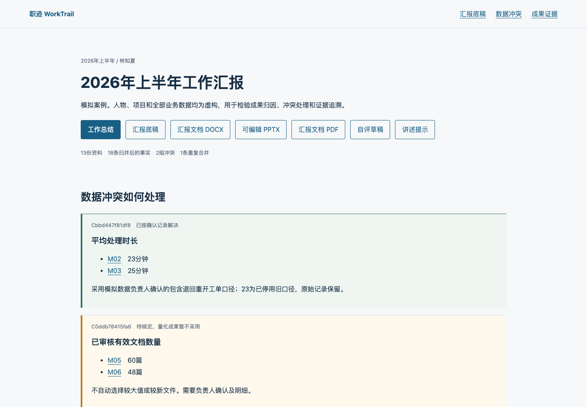

# 职迹 WorkTrail

**简体中文** | [English](README.en.md) · 版本 **1.2.2** · Python **>=3.10** · [MIT](LICENSE)

把本人工作资料整理成有来源的工作内容、成果与成效总结；需要时再生成述职文档、证据页、自评或可编辑PPT。支持本地文件夹、飞书、钉钉、企业微信以及混合资料。默认只做工作总结，不自动生成整套文件。

**可将下面[快速开始](#快速开始)中的话术发送给支持Agent Skills的Agent，让它按自身的安装方式处理。** 详细配置见[安装与首次使用](references/installation.md)，不需要先安装三家平台。只查看示例可双击「打开半年汇报示例.html」。

本项目面向半年/年度总结、转正述职、绩效自评准备和项目复盘，适合希望先核实工作事实、再决定呈现格式的职场人员。它是Skill与CLI工具包，使用者需要自己的AI Agent；单独下载不会自动理解文件。[项目仓库](https://github.com/zty-f/worktrail) · [CI运行记录](https://github.com/zty-f/worktrail/actions/workflows/ci.yml)。

这是独立开源项目，与worktrail.app、worktrail.net及其他同名产品无关联。

**目录**：[快速开始](#快速开始) · [来源与产出](#先选资料-再选产出) · [命令行使用](#命令行使用) · [环境要求](#环境要求) · [平台授权](#安装-授权与失败处理) · [原理与结构](#原理与项目结构) · [示例与测试](#内置示例与验证) · [限制与路线图](#限制与路线图) · [参与与许可](#参与与许可)

## 快速开始

### 1. 安装Skill

将下面这段话发送给你使用的Agent。这是对话指令，无需在终端执行：

```text
请安装这个GitHub仓库中的Skill：https://github.com/zty-f/worktrail。
Skill在仓库根目录，名称为worktrail，请按你当前Agent的安装方式完整安装全部配套文件。
```

安装时应保留scripts、references、assets、examples等配套目录，不能只安装SKILL.md。

### 2. 开始使用

安装完成并确认Agent已识别后，发送：

```text
请使用worktrail Skill，整理我指定文件夹里的工作资料。
只需要工作内容与成效总结，保留依据和待确认项，不生成PPT。
```

随后给出本地资料文件夹的实际路径，并按需要补充本人分工和资料时间范围。若未识别新Skill，按当前Agent的说明刷新Skill列表、新建会话或重启。

本地MD/TXT/CSV采集和轻量总结需要Python >=3.10；使用平台资料时再安装对应CLI并由本人授权，选择PDF/PPT时再检查[环境要求](#环境要求)。需要手动运行脚本时，继续看[命令行使用](#命令行使用)。

## 效果预览

以下为随包虚构半年资料的实际证据页截图。它支持个人/团队筛选、指标冲突查看和精确引文追溯；预览不代表真实企业资料。



[仅工作总结示例](examples/summary-only/output/工作总结.md) · [完整报告PDF](examples/halfyear-demo/output/汇报文档.pdf) · [可编辑PPT](examples/halfyear-demo/output/汇报演示.pptx) · [PPT渲染预览](examples/halfyear-demo/qa/deck-montage.webp)

证据页需要下载项目后在浏览器打开[示例HTML](examples/halfyear-demo/output/index.html)；GitHub文件页本身不会执行其中交互。

## 先选资料 再选产出

| 资料来源 | 使用方式 |
|---|---|
| 本地文件夹 | 选择一个或多个明确资料目录，无需平台登录 |
| 飞书 | 先按[飞书安装授权](references/setup-feishu.md)配置应用、登录，再选择文档/目录候选 |
| 钉钉 | 按[钉钉安装授权](references/setup-dingtalk.md)登录，可先浏览个人空间或指定文件夹 |
| 企业微信 | 按[企微安装授权](references/setup-wecom.md)扫码配置，再选本人相关资料 |
| 混合 | 同时选择本地目录和sources.json中的特定平台文档 |

可以这样对Agent说：

> 读取worktrail/SKILL.md。资料使用我指定的本地文件夹。我只要工作内容与成效总结，保留证据依据和待确认项，不要Word、PDF和PPT。

也可以说：

> 用钉钉的个人空间资料，先列出候选让我选择。我要工作总结和可编辑PPT，不生成PDF。

只需要整理工作时，不必准备完整绩效模板或先决定演示页数。本人分工、事件日期或成效数据缺失时，先列缺口；不编造上线收益、牵头角色或贡献比例。

| 可选产出 | 输出键 |
|---|---|
| 工作内容与成效总结（默认） | summary |
| 汇报底稿 Markdown | report |
| 交互证据页、CSV与来源快照 | evidence |
| Word / PDF / 可编辑PPT | docx / pdf / pptx |
| 自评 / 逐页讲述提示 | self-eval / speaker-notes |
| 明确需要整套 | all |

## 命令行使用

下载完整项目或克隆仓库：

```bash
git clone https://github.com/zty-f/worktrail.git
cd worktrail
```

在项目目录运行，python替换为你的有效解释器；Windows和Mac的具体安装命令见首次使用说明。

```bash
python scripts/review.py init /absolute/my-review
python scripts/review.py configure /absolute/my-review --interactive
python scripts/review.py doctor --outputs summary
```

填写工作区brief.json中的本人、周期和项目。向导会保存本地/平台来源和产出选项；平台资料先完成所选平台的授权。然后：

```bash
python scripts/review.py collect /absolute/my-review
python scripts/review.py packet /absolute/my-review
```

**让Agent实际阅读evidence-packet.json后抽取事实。** CLI不会偷偷调用另一个模型；单独采集不等于已经完成总结。核对facts.json后继续：

```bash
python scripts/review.py import-facts /absolute/my-review /absolute/my-review/facts.json
python scripts/review.py analyze /absolute/my-review
python scripts/review.py build /absolute/my-review
python scripts/review.py verify /absolute/my-review
```

build只生成workflow.json中选择的产出，也可以单次传--outputs summary,pptx。只有summary时，output只有工作总结.md和manifest.json核验记录，不要求Node、PDF或PPT运行时。某项导出失败保留上次成功output，历史版本在builds中。

## 环境要求

- Python >=3.10。MD/TXT/CSV采集及总结、证据页、底稿、自评、讲述提示使用标准库。
- DOCX、文本PDF、XLSX解析分别需要python-docx、pypdf、openpyxl；requirements.txt可一次安装这些Python包。扫描件和图片需另行识别后提供带位置的文字。
- 平台CLI独立安装和授权，只装要用的平台。本Skill不包含你的账号、企业应用密钥或令牌。
- Word/PDF渲染和PPT导出仍依赖目标电脑已有的Codex文档/演示运行时。没有该环境可使用轻量产出；不是安装Node就自动具备完整排版能力。当前完整排版在Mac验证，其他系统未实机验收。详细诊断与替换路径见安装说明。

## 安装 授权与失败处理

三家均有从安装、登录、成功判据、选择资料到最小读取验证的独立步骤，附官方资料来源。选择哪家就读哪份：

- [飞书与Lark](references/setup-feishu.md)：应用配置、user/bot身份、分步OAuth、scope和文档权限。
- [钉钉](references/setup-dingtalk.md)：安装器/npm、浏览器回调与设备码、过期处理、组织CLI开关、PAT与凭据修复。
- [企业微信](references/setup-wecom.md)：Node/CLI版本、authorized判据、扫码初始化、本人身份和类型限制。
- [共同排障](references/setup-troubleshooting.md)：命令找不到、代理/证书、授权过期、账号错误、scope、文档ACL及不明确错误。

```bash
python scripts/review.py auth-check --provider dingtalk
python scripts/review.py doctor --provider dingtalk --check-auth --outputs summary
```

诊断不启动OAuth、不安装软件、不回传原始认证数据。官方CLI可能自行刷新已有凭据。authenticated=true不等于目标文档有权限；先读取一篇用户允许的文档验收。未知状态保留unknown，不按success字段猜测。

截至2026-10-30，钉钉已真实验证个人空间目录分页、选定三篇adoc正文读取及未修改复读。飞书和企微依据官方资料核对命令并做回包/路由测试，尚未完成真实租户端到端验证。真实钉钉资料保存在独立私有目录，不在此Skill或压缩包中。

## 证据和归因

本人工作、团队产出、方案、在途和目标分开。文档作者、文件拥有者、能访问资料都不能自动证明本人负责。口述分工独立保存并标为本人补充。指标按单位、人群、统计窗口和定义核对；冲突未确认不选较大值。没有同口径数据不计算改善百分比。

日期未知可用event_date=null、date_status=unknown和date_note保留；专项核查用brief.report_type=evidence。正式halfyear/annual/probation不把未知日期塞入某个周期。证据页能展开引文、打开采集版本的原文位置，并返回平台原始链接；L编号为CLI Markdown行号，不是云文档原生锚点。

[数据合同](references/data-contract.md) · [成果归因与指标](references/reasoning.md) · [来源与产出配置](references/workflow.md) · [持续积累与修正](references/continuity.md) · [平台类型边界](references/platforms.md) · [验收](references/quality.md)

## 原理与项目结构

资料经过四层处理：选定范围的只读采集 → 带来源版本和位置的账本 → Agent抽取并核对事实 → 脚本检查归因、冲突及所选格式导出。规则能检查引用和数值条件，不能自动证明语义正确或个人独立因果贡献。日常可补记工作，同一账本保留历史；未默认启用定时任务。

```text
worktrail/
├── SKILL.md                 Agent使用入口
├── agents/openai.yaml       Agent展示元数据
├── scripts/                 采集、账本、校验与选择性导出
├── references/              安装、三家平台、合同及质量指引
├── assets/                  证据页面资源与OFL字体
├── examples/                完整及轻量虚构案例、实际输出与QA
├── tests/                   单元测试和浏览器检查
├── .github/                 CI配置、Issue与PR模板
├── CONTRIBUTING.md          贡献说明
└── LICENSE                  MIT许可
```

运行时生成的用户工作区保存brief.json、workflow.json、state和output；它应位于自己的私有目录，不放入公开项目。

## 内置示例与验证

完整示例examples/halfyear-demo含13份虚构半年资料：20条抽取事实合并重复、排除跨期后保留18条；23/25分钟按模拟确认记录采用25，40到25是时长下降37.5%；48/60篇仍未核定；试点18分钟没有混算全量改善；未上线事项没有冒充业务成果。人物、数据和确认人全部虚构。

examples/summary-only使用3份轻量模拟资料、5条已核对事实，仅生成工作总结。examples/evidence-only使用相同的轻量资料，仅生成证据页与CSV，页面不显示未选Word/PDF/PPT的下载按钮。这两个例子的Markdown采集与轻量生成已在不加载第三方Python包的环境中实际跑通。

```bash
python scripts/review.py build examples/halfyear-demo --outputs all
python scripts/review.py verify examples/halfyear-demo
python -m unittest discover -s tests -q
```

create_demo只用于创建模拟资料和测试夹具，不是处理真实文件的入口。双击重新生成模拟案例.command会创建新的runs目录，不覆盖原始示例。

此项目是由Agent理解资料、脚本采集/校验/导出的Skill工具包。核心脚本不需要模型API key；AI Agent本身的账号和用量由用户自己的环境提供。原文进入当前Agent配置的模型处理，本地账本不代表全部推理离线。默认不注册定时任务、不提交绩效、不发送消息、不回写云端。

本地验证记录：79项单元测试；完整证据页24项、轻量证据页14项浏览器检查；总结、证据、仅PDF、仅PPT和整套实际导出通过。核验详情见[产出选择QA](examples/halfyear-demo/qa/output-selection-report.json)。[GitHub CI](https://github.com/zty-f/worktrail/actions/workflows/ci.yml)覆盖公开Python依赖、单元测试、克隆后的随包示例核验及轻量流程；实际状态以运行记录为准，不代表真实平台或Office视觉验收。

## 限制与路线图

| 事项 | 当前边界 |
|---|---|
| 理解新资料 | 依赖当前Agent真实阅读与语义核对，脚本没有内置独立抽取模型 |
| PDF/PPT完整导出 | 依赖宿主Codex排版运行时；轻量总结不依赖该组件 |
| 平台接入 | 钉钉选定adoc路径已实测；飞书、企微尚待真实租户验收 |
| 资料类型 | 扫描件、图片、附件与未适配表格需先识别或合法导出 |
| 兼容性 | 完整排版在Mac验证；未在原生PowerPoint/WPS或其他系统完成验收 |
| 语言 | 中英文README与英文上手/平台摘要可用；详细合同和部分操作参考仍为中文；默认导出标题/文件名为中文 |

后续优先方向：公开可安装的导出后端、飞书/企微真实租户验收、跨系统字体与Office兼容性，以及更完整的英文操作参考。这些是方向，不是已经完成的功能或交付日期承诺。

## 参与与许可

[贡献指南](CONTRIBUTING.md) · [使用支持](SUPPORT.md) · [安全问题](SECURITY.md) · [行为准则](CODE_OF_CONDUCT.md) · [更新记录](CHANGELOG.md) · [公开发布前检查](references/releasing.md)

原创代码与说明采用[MIT](LICENSE)；随包Noto字体保留[SIL OFL 1.1](assets/fonts/OFL.txt)。外部平台CLI、依赖和宿主运行时保留各自许可且没有随包分发；详见[第三方说明](THIRD_PARTY.md)。本项目是独立工具，不代表飞书、钉钉、企业微信或OpenAI官方产品。

欢迎提交[Issue](https://github.com/zty-f/worktrail/issues)与[PR](https://github.com/zty-f/worktrail/pulls)，反馈请使用虚构样例。漏洞通过已启用的[私密报告入口](https://github.com/zty-f/worktrail/security/advisories/new)提交，不在公开Issue上传凭据或真实企业资料。
